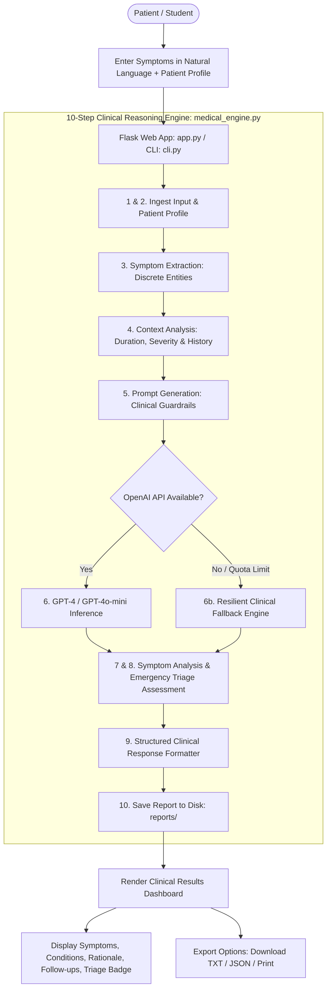

# 🩺 AI-Powered Medical Symptom Assistant using GPT-4 (gpt_exp6)

[](https://www.python.org/)
[](https://flask.palletsprojects.com/)
[](https://openai.com/)
[](LICENSE)

An intelligent, clinical-grade **AI Medical Symptom Assistant & Triage Platform** powered by **GPT-4 / GPT-4o-mini** and **Flask**. Designed to interpret natural-language patient symptom descriptions, cross-reference patient profiles, assess emergency red flags, communicate clinical uncertainty, generate structured medical summaries, and archive clinical records.

> **Important Medical Disclaimer**: This system is designed for educational, informational, and triage-demonstration purposes. It provides structured symptom analysis and triage guidance but does **not** establish a formal medical diagnosis. Users experiencing severe, worsening, or acute emergency symptoms must seek immediate professional emergency medical care.

---

## 📌 Table of Contents

- [Overview](#-overview)
- [Why Natural Language AI for Symptoms?](#-why-natural-language-ai-for-symptoms)
- [Key Features](#-key-features)
- [Complete 10-Step Clinical Workflow](#-complete-10-step-clinical-workflow)
- [System Architecture](#-system-architecture)
- [Standard Structured Output Schema](#-standard-structured-output-schema)
- [Project Structure](#-project-structure)
- [Prerequisites](#-prerequisites)
- [Installation & Setup](#-installation--setup)
- [Running the Application](#-running-the-application)
  - [1. Web Interface (Flask Dashboard)](#1-web-interface-flask-dashboard)
  - [2. Terminal CLI Diagnostic Mode](#2-terminal-cli-diagnostic-mode)
- [Demonstration Scenarios](#-demonstration-scenarios)
- [Viva Voce Questions & Technical Answers](#-viva-voce-questions--technical-answers)
- [License](#-license)

---

## 🌟 Overview

Traditional symptom-checking applications force patients to navigate rigid, binary checklists (e.g., `Fever = Yes`, `Cough = Yes`, `Chest Pain = No`). This loses critical qualitative nuances such as the character of pain (throbbing vs. dull), onset speed, temporal progression, and contextual medical history.

The **AI-Powered Medical Symptom Assistant**:
1. **Understands Conversational Language**: Patients describe symptoms naturally (e.g., *"I've had a sore throat, mild fever, and cough since yesterday"*).
2. **Contextual Evaluation**: Integrates age, sex, symptom duration, subjective severity, pre-existing conditions, medications, and allergies.
3. **Emergency Escalation (Red Flags)**: Flags life-threatening presentations (e.g., radiating chest pain, severe dyspnea, acute neurological deficits) for immediate triage.
4. **Zero-Credit Intelligent Fallback**: Features a built-in medical diagnostic fallback engine so laboratory demonstrations run reliably even without active OpenAI credits.
5. **Full Clinical Documentation**: Persists every generated report with unique IDs in `reports/` in `.txt` and `.json` formats.

---

## 💡 Why Natural Language AI for Symptoms?

| Parameter | Traditional Rule Systems | AI-Powered Symptom Assistant (GPT-4) |
| :--- | :--- | :--- |
| **Input Style** | Rigid boolean forms (`Fever: Yes/No`) | Conversational free-form text |
| **Nuance Capture** | Misses descriptive details | Captures severity, onset, pain quality, triggers |
| **Uncertainty** | Misleading certainty or error | Expresses clinical uncertainty (*"Possible explanations..."*) |
| **Safety Guardrails**| Static hardcoded warnings | Dynamic emergency red-flag triage detection |
| **Data Output** | Plain text or static PDFs | Structured JSON matching clinical reporting standards |

---

## 🚀 Key Features

| Capability | Description | Module |
| :--- | :--- | :--- |
| **🗣️ Natural Language Parsing** | Parses unstructured patient descriptions into discrete clinical entities. | `medical_engine.py` |
| **🩺 Patient Profile Context** | Cross-references age, sex, symptom duration, severity, history, medications, and allergies. | `medical_engine.py` |
| **🚨 Emergency Red Flag Detection** | Scans for acute life-threatening presentations and triggers urgent emergency advisories. | `medical_engine.py` |
| **📋 Structured JSON Clinical Reports** | Enforces structured output schema (`response_format={"type": "json_object"}`). | `medical_engine.py` |
| **🛡️ Zero-Credit Resilient Fallback** | Automatic fallback engine ensures uninterrupted testing during exams or viva evaluations. | `medical_engine.py` |
| **💾 Multi-Format Report Archival** | Auto-saves reports with unique UUIDs to `reports/` with instant `.txt`, `.json`, copy, and print actions. | `app.py` |
| **🖥️ Dual Execution Modes** | Rich interactive healthcare web dashboard plus lightweight terminal CLI demonstrator. | `app.py` & `cli.py` |

---

## 🔄 Complete 10-Step Clinical Workflow

The architecture implements the 10-step clinical pipeline specified in the syllabus:

```text
1. User Input (natural language symptom description)
       │
2. Patient Profile (age, sex, severity, medical history, medications, allergies)
       │
3. Symptom Extraction (discrete clinical findings identified from raw text)
       │
4. Context Analysis (duration, progression, pre-existing conditions checked)
       │
5. Prompt Generation (clinical system instructions, safety guardrails, schema)
       │
6. GPT-4 Execution (OpenAI Chat Completions API with structured JSON output)
       │
7. Symptom Analysis (symptoms, possible conditions, follow-up questions)
       │
8. Risk / Escalation Assessment (triage level: Low, Moderate, High, Emergency)
       │
9. Structured Response (exact clinical reporting format)
       │
10. Save Report (file persistence, audit trail, exportable TXT/JSON/print)
```

---

## 🏗️ System Architecture



---

## 📄 Standard Structured Output Schema

Every analysis strictly adheres to the standardized clinical reporting format:

```text
MEDICAL SYMPTOM ANALYSIS
--------------------------------
Reported Symptoms:
• Fever
• Cough
• Sore throat

Duration:
2 days

Possible Conditions:
1. Common cold
2. Influenza
3. Other respiratory infection

Why These Were Considered:
The reported symptoms can occur with several respiratory conditions.

Additional Information Needed:
• Exact temperature
• Severity of symptoms
• Breathing difficulty
• Other associated symptoms

Medical Attention:
Seek professional medical evaluation if symptoms are severe, worsening or concerning.

Disclaimer:
This is an informational AI analysis and not a medical diagnosis.
--------------------------------
```

---

## 📂 Project Structure

```
gpt_exp6/
├── reports/                # Auto-saved clinical symptom reports (.txt and .json)
│   └── .gitkeep
├── static/
│   ├── script.js           # AJAX client, pipeline step animations, report downloads
│   └── style.css           # Healthcare CSS design system, severity & triage badges
├── templates/
│   └── index.html          # Clean, responsive single-page clinical dashboard
├── app.py                  # Flask web backend with REST APIs and report handling
├── cli.py                  # Terminal-based interactive clinical diagnostic demonstrator
├── medical_engine.py       # Core 10-step clinical reasoning engine, prompt builder, & fallback
├── requirements.txt        # Python dependencies (flask, openai, python-dotenv)
├── .env.example            # Environment configuration template
├── .gitignore              # Git ignore rules
├── LICENSE                 # MIT Open Source License
└── README.md               # Project documentation & viva preparation guide
```

---

## ⚙️ Prerequisites

- **Python 3.9+** installed on your workstation.
- *(Optional)* An **OpenAI API Key** with GPT-4 / GPT-4o-mini access. If no key is configured, the system operates seamlessly using its built-in intelligent diagnostic fallback engine.

---

## 📦 Installation & Setup

### 1. Clone the Repository
```bash
git clone https://github.com/rhemiSINGH26/gpt_exp6.git
cd gpt_exp6
```

### 2. Create and Activate a Virtual Environment
- **On Windows (PowerShell):**
  ```powershell
  python -m venv venv
  .\venv\Scripts\Activate.ps1
  ```
- **On macOS / Linux:**
  ```bash
  python3 -m venv venv
  source venv/bin/activate
  ```

### 3. Install Dependencies
```bash
pip install --upgrade pip
pip install -r requirements.txt
```

### 4. Configure Environment Variables
Copy `.env.example` to `.env`:
```bash
cp .env.example .env
```
*(On Windows PowerShell: `Copy-Item .env.example .env`)*

Edit `.env` with your OpenAI credentials:
```env
OPENAI_API_KEY=your_openai_api_key_here
OPENAI_MODEL=gpt-4o-mini
FLASK_SECRET_KEY=medical_symptom_assistant_secret_2026
PORT=5000
```

---

## 🎮 Running the Application

### 1. Web Interface (Flask Dashboard)
```bash
python app.py
```
- Open your browser at: **`http://127.0.0.1:5000`**
- Use the **Quick Scenario Presets** (Respiratory, Headache, Emergency Chest Pain) or enter custom patient parameters.
- Click **Analyze Symptoms** to trigger the 10-step analysis pipeline.
- Download the generated report as `.txt` or `.json`, or print directly from the browser.

### 2. Terminal CLI Diagnostic Mode
For rapid terminal-based viva demonstrations:
```bash
python cli.py
```
Choose from pre-configured clinical cases or enter interactive manual mode.

---

## 🧪 Demonstration Scenarios

| Scenario | Input Symptoms | Triage Level | Possible Explanations |
| :--- | :--- | :--- | :--- |
| **1. Upper Respiratory** | *"I have had a sore throat, mild fever and cough for 2 days."* | **Low / Moderate** | Common cold, Viral pharyngitis, Influenza |
| **2. Neurological / Headache** | *"Throbbing headache on one side of head, sensitivity to light, nausea."* | **Moderate** | Migraine, Tension headache, Eye strain |
| **3. Emergency Red Flag** | *"Crushing chest pain radiating to left arm and jaw, shortness of breath."* | **🚨 Emergency** | Acute Coronary Syndrome (ACS), Pulmonary Embolism |

---

## 🎓 Viva Voce Questions & Technical Answers

### Q1: What is the primary objective of this project?
**A:** To design and implement an AI-powered medical symptom assistant using GPT-4 that interprets conversational patient symptom descriptions, cross-references patient context, communicates uncertainty, assesses emergency red flags, and generates a standardized clinical report.

### Q2: Why is conversational input superior to traditional symptom checklists?
**A:** Checklists force binary inputs (`Fever = Yes`, `Cough = Yes`), stripping nuances such as progression over time, pain quality, triggers, and subjective severity. GPT-4 extracts discrete clinical findings directly from natural language while retaining contextual subtleties.

### Q3: Why must medical AI systems communicate clinical uncertainty?
**A:** An AI cannot legally or ethically establish a confirmed medical diagnosis. Many benign and life-threatening conditions present with overlapping symptoms. The assistant must use probabilistic language (*"Possible explanations may include..."*) and emphasize that symptoms alone do not constitute a diagnosis.

### Q4: How does the system handle life-threatening emergencies?
**A:** The engine performs multi-layered red-flag screening (regex patterns and LLM classification) for acute cardiovascular, neurological, and respiratory emergencies (e.g., chest pain radiating to the jaw, sudden facial drooping). If detected, it escalates triage to `Emergency` and advises immediate emergency care (calling 911 / 112 / 108).

### Q5: How are hallucinations prevented in clinical summaries?
**A:**
1. **Low Temperature**: Set to `0.2` to minimize stochastic variability.
2. **Strict System Prompt Constraints**: Explicitly forbids inventing data or presenting conditions as confirmed diagnoses.
3. **Structured JSON Schema**: Enforces output strictly into defined fields.
4. **Context Grounding**: Analysis is strictly bound to reported age, duration, history, and symptoms.

### Q6: What is the role of Step 10 ("Save Report") in the pipeline?
**A:** It persists the clinical analysis with a unique UUID into the server's `reports/` directory as both human-readable text and structured JSON. This guarantees an audit trail and allows patients to export and share their summary with a healthcare professional.

---

## 📄 License

This project is licensed under the [MIT License](LICENSE).
